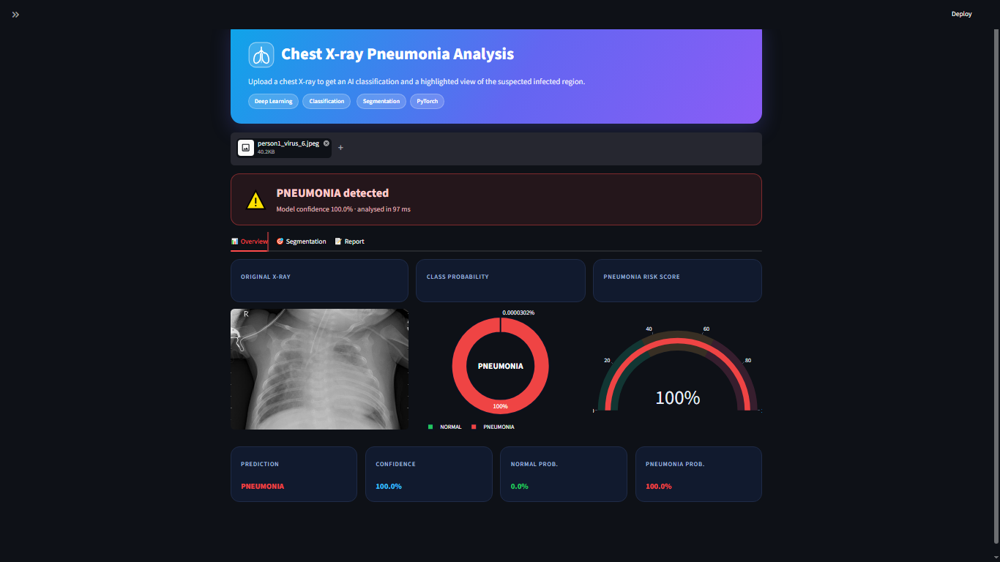
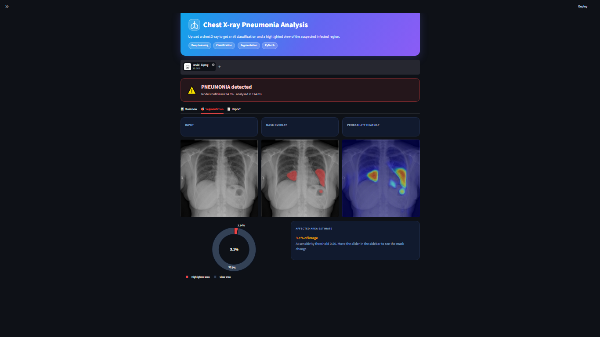

Chest X-ray Pneumonia Detection

A deep-learning project built with PyTorch and Streamlit for chest X-ray image classification and segmentation. It combines a ResNet18-based classifier with a U-Net segmentation model to demonstrate two complementary computer-vision tasks in one interactive application.

Disclaimer: This project is for learning and research demonstrations only. It is not a medical device and must not be used for diagnosis, treatment, or clinical decision-making.

  
  

Project overview

The application accepts one chest X-ray image and runs it through the available models. The classifier predicts NORMAL or PNEUMONIA and displays class probabilities and confidence. If the segmentation checkpoint is installed and segmentation is enabled, the app also displays a predicted mask overlay, probability heatmap, and estimated highlighted area.

Model components

Task
Model
Output
Image classification
ResNet18 classifier
NORMAL / PNEUMONIA class probabilities and predicted label
Image segmentation
U-Net with a ResNet18 encoder
Pixel-wise infection probability map, mask overlay, and heatmap

Application screenshots

Classification dashboard

Segmentation results

Machine-learning workflow

1.
Upload an original chest X-ray (.png, .jpg, or .jpeg) in the Streamlit app.

2.
The classifier preprocesses the image and returns NORMAL/PNEUMONIA probabilities.

3.
If the segmentation model is available and enabled, the same uploaded X-ray is resized and passed to the U-Net model.

4.
The app presents the classifier output and segmentation visualization in separate tabs.

Upload the original X-ray image—not a segmentation mask. The app generates a mask prediction itself.

Datasets and interpretation

The project uses different datasets for the two tasks: the classification component is described in the app as using the Kaggle Chest X-Ray Pneumonia dataset, while segmentation uses COVID-QU-Ex infection-mask data. As a result, the models may behave differently on images outside the data distribution they were trained on.

The segmentation model can still produce an overlay for an image from the classification test set, but an overlay appearing only confirms that inference ran. It does not prove that the highlighted region is accurate. Evaluate each model against data and ground truth appropriate to that task; for segmentation, compare predictions with the corresponding ground-truth masks where available.

Technology stack

•
Python — application and model code

•
PyTorch / Torchvision — neural-network training and inference

•
ResNet18 — image-classification backbone and U-Net encoder

•
U-Net — pixel-wise segmentation architecture

•
Streamlit — interactive web application

•
OpenCV, NumPy, Pillow — image processing

•
Plotly — probability charts and risk gauge

•
Albumentations, scikit-learn, Matplotlib, Pandas, tqdm — training/evaluation utilities listed in requirements.txt

Repository structure

Plain Text

.
├── app.py                      # Streamlit inference and dashboard
├── cls_model.py                # Classification model definition
├── config.py                   # Image sizes and project configuration
├── classification_train.py     # Classifier training
├── classification_evaluate.py  # Classifier evaluation
├── segmentation_dataset.py      # Segmentation dataset/data loading
├── segmentation_train.py       # U-Net training
├── predict.py                  # Prediction utility
├── check_data.py               # Dataset inspection utility
├── requirements.txt            # Python dependencies
├── assets/
│   ├── app-screenshot.png
│   └── segmentation-screenshot.png
├── data/                       # Local datasets; not included
├── models/                     # Local model checkpoints; not included
└── results/                    # Local outputs; not included

Setup

Clone the repository and move into its directory:

Bash

git clone https://github.com/jayeshbaviskar345-ai/chest-xray-pneumonia-detection.git
cd chest-xray-pneumonia-detection

Create and activate a virtual environment, then install the dependencies from requirements.txt.

Windows PowerShell:

Plain Text

python -m venv .venv
.venv\Scripts\Activate.ps1
pip install -r requirements.txt

macOS / Linux:

Bash

python -m venv .venv
source .venv/bin/activate
pip install -r requirements.txt

For a specific CUDA setup, install compatible torch and torchvision builds using the official PyTorch installation selector, then install the remaining project dependencies.

Checkpoints

The application expects the classifier checkpoint at:

Plain Text

models/resnet18_pneumonia.pth

The segmentation checkpoint is optional and expected at:

Plain Text

models/unet_seg.pth

The classifier checkpoint is required to start the app. Without the segmentation checkpoint, classification remains available but segmentation is unavailable. Check config.py and the training scripts for dataset paths, input sizes, and checkpoint-saving locations. The checkpoint architecture and class order must match the code (NORMAL, then PNEUMONIA).

Datasets and trained checkpoints are not included in this repository. Avoid committing private or restricted data. If sharing large checkpoint files, use Git LFS or provide a documented download method.

Run the application

From the repository root, with the environment activated and the required classifier checkpoint in place:

Bash

streamlit run app.py

Open the local URL printed by Streamlit, upload an X-ray, and explore the Overview, Segmentation, and Report tabs. Segmentation additionally requires models/unet_seg.pth and the segmentation toggle enabled in the sidebar.

Training and evaluation

The repository includes scripts for training and evaluating the classification and segmentation models. Before running them, review config.py and the relevant scripts to configure dataset paths and confirm the expected directory structure. Keep training, validation, and test splits separate, and evaluate segmentation with matching ground-truth masks where possible.

Responsible use

•
Predictions and visualizations may be incorrect and can be unreliable on data that differs from the training datasets.

•
Do not use this software for clinical diagnosis or healthcare decisions.

•
Do not upload identifiable medical images to a deployment unless you have proper authorization, consent, and safeguards.

•
Follow the dataset owners' terms and licenses when using or redistributing datasets.

License

No license is currently specified. Add a license file if you intend to grant others permission to use, modify, or distribute this project.

